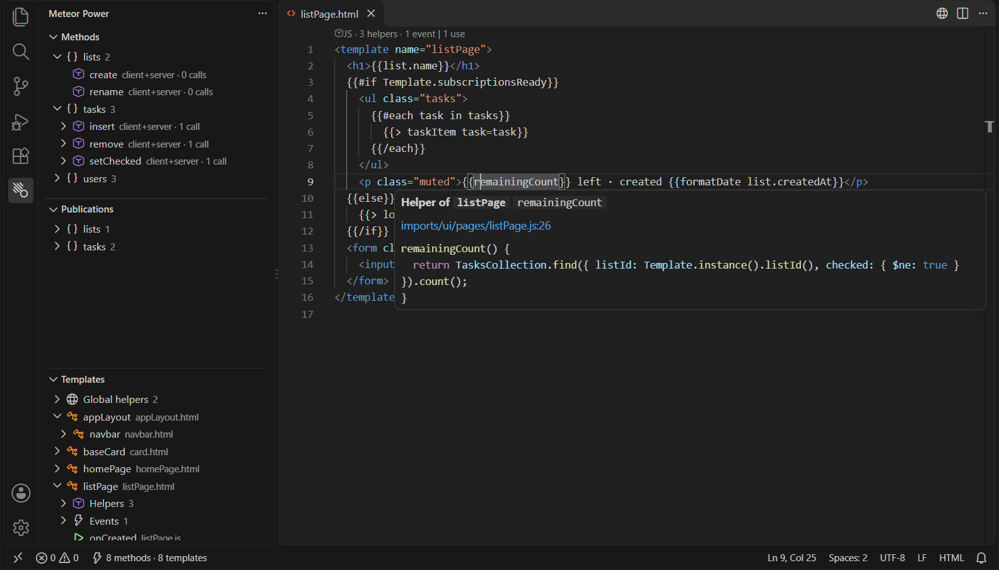
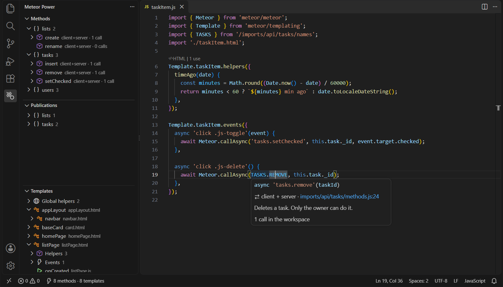
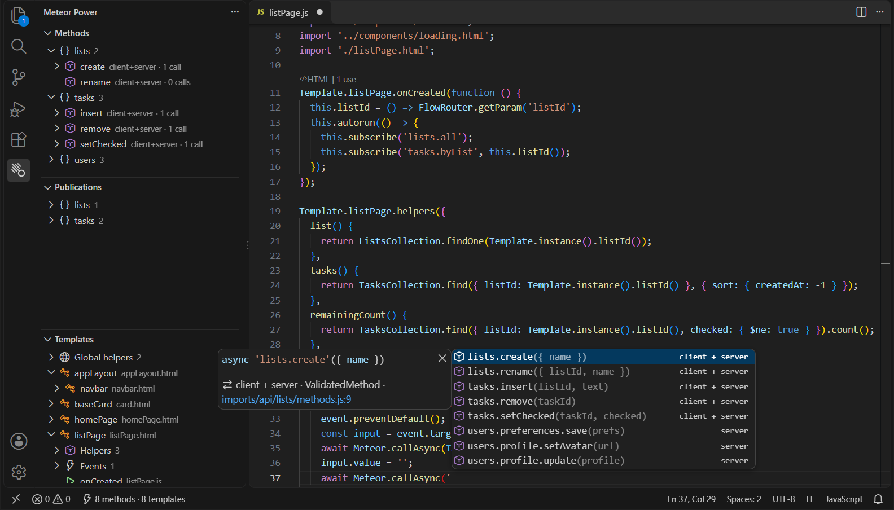
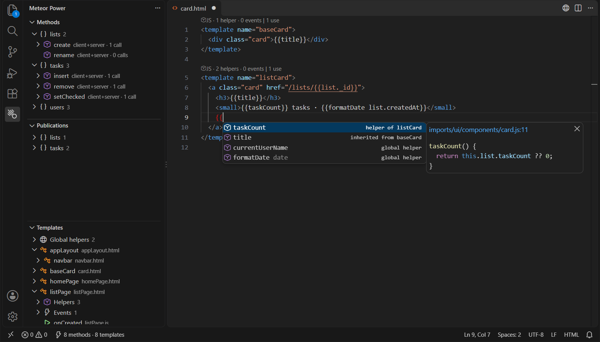
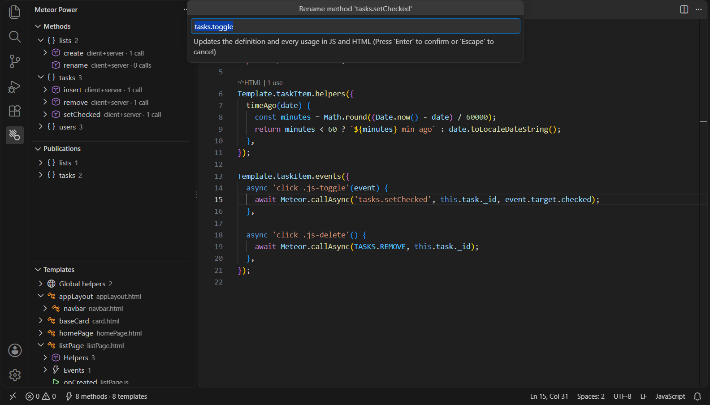
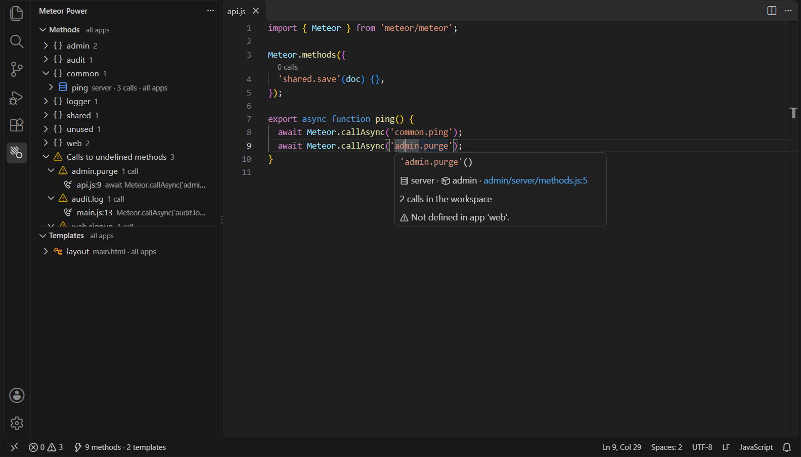

# Meteor Power

Navigate **Meteor 3** and **Blaze** projects as if names were real symbols instead of strings.

Meteor Power indexes the whole workspace and links things **by name**, so it works even when HTML, JS, methods and constants live in different folders.



## Methods and publications

| Where | What it does |
|---|---|
| `Meteor.call/callAsync/apply/applyAsync('name')` | **Ctrl+Click / F12** goes to the definition in `Meteor.methods` or `new ValidatedMethod({ name })` |
| `insertTask.call(...)`, `callAsync`, `Tasks.insertTask`, `insertTask.name` | calls through a **ValidatedMethod object** (also imported, aliased or via `import * as`) go to the method too |
| `Meteor.subscribe('name')`, `this.subscribe(...)` | goes to `Meteor.publish('name')`, including the object form, and `Meteor.publishComposite` / `FindFromPublication.publish` |
| On a definition | **Ctrl+Click / Shift+F12** lists every call |
| Inside the string | **completion** of the names, with parameters and docs |
| Hover | signature, environment (server/client), file, JSDoc, number of calls |
| CodeLens | `N calls` above each method, `N subscriptions` above each publication |
| Diagnostics | warning on calls to undefined methods or publications (Information when some Meteor packages could not be read) |





Names can also be **constants**, resolved across the whole workspace:
`Meteor.callAsync(USERS_METHODS.RESET)`, `[USERS_METHODS.RESET]() {}`, TypeScript enums and `Object.freeze({...})`, also through
`import { USERS_METHODS as UM }`, `import * as C`, `import NAMES from './names'` (default export), `const { RESET } = USERS_METHODS`.

Methods and publications can be **registered from another module**: `Meteor.methods(sampleMethods)` with `sampleMethods`
imported (named or default export), spread into another object (`{ ...sampleMethods, ...other }`), built in a local
variable or with `Object.assign`, also with computed keys (`methods[NAMES.SAVE] = fn`, `{ [name]: fn }` with a
constant `name`). An object that is never registered does not define anything. Keys added under a condition or from
another function make the method *conditional*: calls to it are not reported, and the hover says so. Registrations that
cannot be followed statically (`Meteor.methods(buildMethods())`, keys computed at run time) are listed in **Meteor Power: Show Log**.

### Meteor packages

Methods, publications, templates and global helpers defined by the **Meteor packages** of each app (Atmosphere and core
packages listed in `.meteor/versions`) count as definitions, so calling them is not an error. Their code is read from:

1. the last build of the app, `.meteor/local/build/programs/*/packages/*.js` (written by `meteor run`);
2. otherwise the Meteor package cache, `<warehouse>/packages/<name>/<version>` for the version selected in
   `.meteor/versions` (never another one), through its metadata (`isopack.json` and one JSON file per architecture).
   `<warehouse>` is `METEOR_WAREHOUSE_DIR`, or `%LOCALAPPDATA%\.meteor` on Windows and `~/.meteor` elsewhere.

Only one server and one client architecture are read (`web.browser.legacy` and `web.cordova` would only repeat the same
definitions), and where the code runs counts: methods and publications come from the server code (on the client they
are stubs), templates and helpers from the client code. Packages declared `testOnly` define names for test code only.
Besides `Meteor.methods` and `Template.x = new Template(...)`, packages register through the DDP server
(`Meteor.server.methods`, an object keeping it, `this._server = server || Meteor.server`) and through
`Blaze.registerHelper` / `UI.registerHelper`; a local object named `Blaze` or `server` is not taken for them.

That code is never diagnosed or renamed, and it is not listed in the side panel; **Ctrl+T** shows its definitions
with the package name, and an app sees only the packages it uses. When the code of a package is unknown (not built on
this machine and not in the package cache, or present but not parsable), problems are still reported, but as
**Information**, naming those packages and why. **Meteor Power: Show Log** says where each app's packages were read
from. Files opened in an editor from outside the workspace (a package, any other folder) are never indexed, except
in `meteorPower.packageDirs`.

### Test code

Definitions in test files (`*.test.js`, `*.spec.js`, `*.app-test.js`, … and anything in a `tests/` folder of the app)
are loaded by Meteor only in test mode: they satisfy calls from test code, while the app's own code calling them gets
`… is only defined in test files, which the app does not load.`

### What is a subscription

`.subscribe('name')` is checked only when it is certainly a DDP subscription: `Meteor.subscribe`, `Meteor.connection.subscribe`,
`this.subscribe` inside `onCreated` / `onRendered` / `onDestroyed`, a variable holding that `this`, `Template.instance().subscribe`,
the template instance argument of an event handler, a `SubsManager` / `SubsCache`, and `useSubscribe` from `meteor/react-meteor-data`.
Other receivers (`eventBus.subscribe('x', handler)`, a `DDP.connect()` to another server) still navigate to a publication with
that name but are never reported as missing. `Meteor` means the framework object: `import { Meteor as M } from 'meteor/meteor'`
is followed, a `Meteor` imported from another module or declared in the file is not.

### Your own wrappers

If your project defines or calls methods through its own functions instead of `Meteor.methods` / `Meteor.callAsync`, list them in the settings and they are handled like the Meteor APIs:

```jsonc
// .vscode/settings.json
{
  "meteorPower.methods.defineFunctions": ["createMethod", "defineMethods"],
  "meteorPower.methods.callFunctions": ["callMethod"],
  "meteorPower.publications.defineFunctions": ["createPublication"],
  "meteorPower.publications.subscribeFunctions": ["useSubscribe"]
}
```

Supported shapes: `fn('name', handler)`, `fn('name', { run })`, `fn({ name: 'x', run() {} })`, `fn({ 'a.b'() {}, 'a.c'() {} })` and the same with `new`. Callers take the name as first argument, or `{ name: 'x' }`.
A bare name (`callMethod`) matches both `callMethod(...)` and `Api.callMethod(...)`; a full path (`Api.callMethod`) matches only that.

## Blaze

| Where | What it does |
|---|---|
| `{{helper}}` in HTML | goes to `Template.x.helpers({ helper })`, otherwise to `Template.registerHelper('helper')` |
| `{{> name}}`, `{{#name}}`, `{{> Template.dynamic template="name"}}` | goes to `<template name="name">` |
| `<template name="x">` | goes to the template JS (helpers, events, onCreated, …) |
| `Template.x` in JS | goes to the HTML |
| `BlazeLayout.render('layout', { main: 'page' })` | goes to the templates |
| Event map key `'click .js-save'` | goes to the elements with that class or id in the HTML |
| On a helper definition | finds where it is used in the HTML |
| Inside `{{ }}` | completion of the current template's helpers and the global ones; template names after `{{>` |
| **Alt+O** | switches between the HTML and the JS of the template |

Local variables (`{{#each item in items}}`, `{{#let}}`) and data context fields are never reported as errors.
Templates created in JavaScript (`Template.samplePanel = new Template(...)`) and helpers holding a template
(`{{> panelHelper}}`) are found too; only exact names are reported, and only in apps using Blaze (`templating`,
`blaze-html-templates`, … in `.meteor/versions`): elsewhere `{{> x}}` belongs to another template language.



### Template inheritance (aldeed:template-extension)

| Call | Effect |
|---|---|
| `Template.child.inheritsHelpersFrom('parent')` (or an array) | `{{helper}}` in `child` goes to the helper of `parent`; completion, references and rename follow it |
| `Template.child.inheritsEventsFrom('parent')` | the event selectors of `parent` also match the elements of `child` |
| `Template.child.replaces('parent')` | `child` uses the helpers and events of `parent` |
| `Template.base.copyAs('copy')` | `{{> copy}}` is a known template, going to the `copyAs` call; it has the helpers and events of `base` |

The template names inside these calls are navigable and renamed with the template.

## Rename (F2)

Press **F2** on a method, publication, template or helper, wherever it appears (definition, call, HTML), to rename it everywhere:

| Renaming | Updates |
|---|---|
| Method / publication | the definition and every call or subscription; if the name comes from a constant (`[USERS_METHODS.RESET]`, `import NAMES from ...`), the constant's string is renamed and the references keep working |
| Template | `<template name>`, `{{> x}}`, `{{#x}}…{{/x}}`, `Template.dynamic template="x"`, `Template.x` in JS, `BlazeLayout.render('x')` |
| Helper | the key in `Template.x.helpers` (or `Template.registerHelper`) and its usages in the template HTML (every template, for global helpers) |



Names that already exist are refused. Template and helper names must be valid identifiers.
The changes are left unsaved, like any rename in VS Code: review them and save with **Ctrl+K S** (*Save All*).

## Several apps in one workspace

Every folder containing `.meteor/release` is an app, and each file belongs to the apps that contain it:

- **Shared code linked into several apps** (symlinked folders) belongs to all of them: it is indexed once, and a method defined there exists in every app that links it. This relies on VS Code following symlinks in searches (`search.followSymlinks`, on by default).
- **Local packages** (folders with `package.js`, in `packages/` or anywhere in the workspace) belong to the apps listing them in `.meteor/packages`, directly or through other local packages (`api.use` / `api.imply`).
- Everything else outside the apps (e.g. a package nobody uses) is visible from every app.

Then everything is resolved inside the app of the file you are in: `Meteor.callAsync('x')` in app A goes to A's definition (or the shared one), never to app B's;
`{{> layout}}` and `{{title}}` find app A's template and helpers even when app B has templates with the same names; constants with the same name and different values in each app are resolved per app.

From shared code, everything of every app linking it is visible, and the diagnostics report names that are missing in **some** of those apps:
`Meteor method 'admin.purge' is not defined in app 'web'.` (the shared file runs in `web` too, where the call would fail).



Rename (F2) changes only the apps that use the name; if shared code uses it, all the apps linking that code are renamed together.

In the side panel the **filter** button (*Show App…*) shows the methods, publications and templates of a single app; with *All apps* each item shows the apps it is defined in.
Packages outside the workspace can be added with `meteorPower.packageDirs` (`METEOR_PACKAGE_DIRS` is read too).

## Side panel

The Meteor Power icon in the Activity Bar opens:

- **Methods**: a tree grouped by namespace (`users.profile.save` → users › profile › save), with environment, number of calls and the list of call sites. A separate group collects calls to undefined methods.
- **Publications**: same structure, with the subscriptions.
- **Templates**:
  - **hierarchical** view, i.e. the tree of `{{> …}}` inclusions
  - **flat** view
  - for each template: helpers, inherited helpers, events and lifecycle callbacks, buttons to open the HTML or the JS, and a group with the global helpers
- With several Meteor apps, a filter to show a single app.

Quick commands (Ctrl+Shift+P): *Meteor Power: Go to Method… / Go to Publication… / Go to Template…*.
**Ctrl+T** also finds methods, publications and templates.

## Settings

- `meteorPower.include` / `meteorPower.exclude`: which files to index. The `public/` (static files) and `private/` (server assets)
  folders of each Meteor app (next to its `.meteor`) are not app code and are never indexed; other folders with those names are.
  Output of `meteor build` (any folder with its `star.json`, even renamed or moved) is never indexed, like `node_modules`
  and `.meteor/local`.
  `exclude` is read in order and the last matching glob wins; `!` includes again what an earlier glob excludes:

  ```json
  "meteorPower.exclude": ["**/node_modules/**", "**/build/**", "!imports/ui/build/**", "private/**"]
  ```

  Globs starting with `**/` match anywhere, the others are relative to the workspace folder. The easy way is the
  Explorer: right-click a file or folder → **Exclude from Meteor Power** / **Include in Meteor Power** (several
  can be selected); the list is updated in the workspace settings and the workspace is reindexed.
- `meteorPower.packageDirs`: folders of local packages outside the workspace (like `METEOR_PACKAGE_DIRS`).
- `meteorPower.methods.defineFunctions` / `callFunctions`, `meteorPower.publications.defineFunctions` / `subscribeFunctions`: your own wrappers, see above.
- `meteorPower.diagnostics.enabled`, `meteorPower.diagnostics.severity`: turn the reported problems on or off and choose their severity.
- `meteorPower.diagnostics.ignoreMethods` / `ignorePublications` / `ignoreTemplates`: names provided by packages that should not be reported. They support `*`, e.g. `"accounts.*"`.
- `meteorPower.codeLens.enabled`: show or hide the CodeLens.

## Large workspaces

Files are parsed on several worker threads: a workspace with 26,000 files is indexed in about 5 seconds.
Minified bundles and files over 1.5 MB are skipped.

If indexing is slow, run **Meteor Power: Show Log**: it lists how long each phase took, the slowest files and the
heaviest folders. Folders that are not Meteor code (generated files, vendored libraries) can be added to `meteorPower.exclude`.

## Development

```bash
npm install
npm test                  # unit tests on the core (parsers + index)
npm run test:integration  # tests inside VS Code (uses the installed VS Code)
npm run package           # builds meteor-power-<version>.vsix
npm run screenshots       # retakes the README screenshots from docs/demo (Windows)
node out/test/perf/run.js # indexing time on a large generated workspace (after npm run test:integration)
```

To debug it, open this folder in VS Code and press **F5**.
